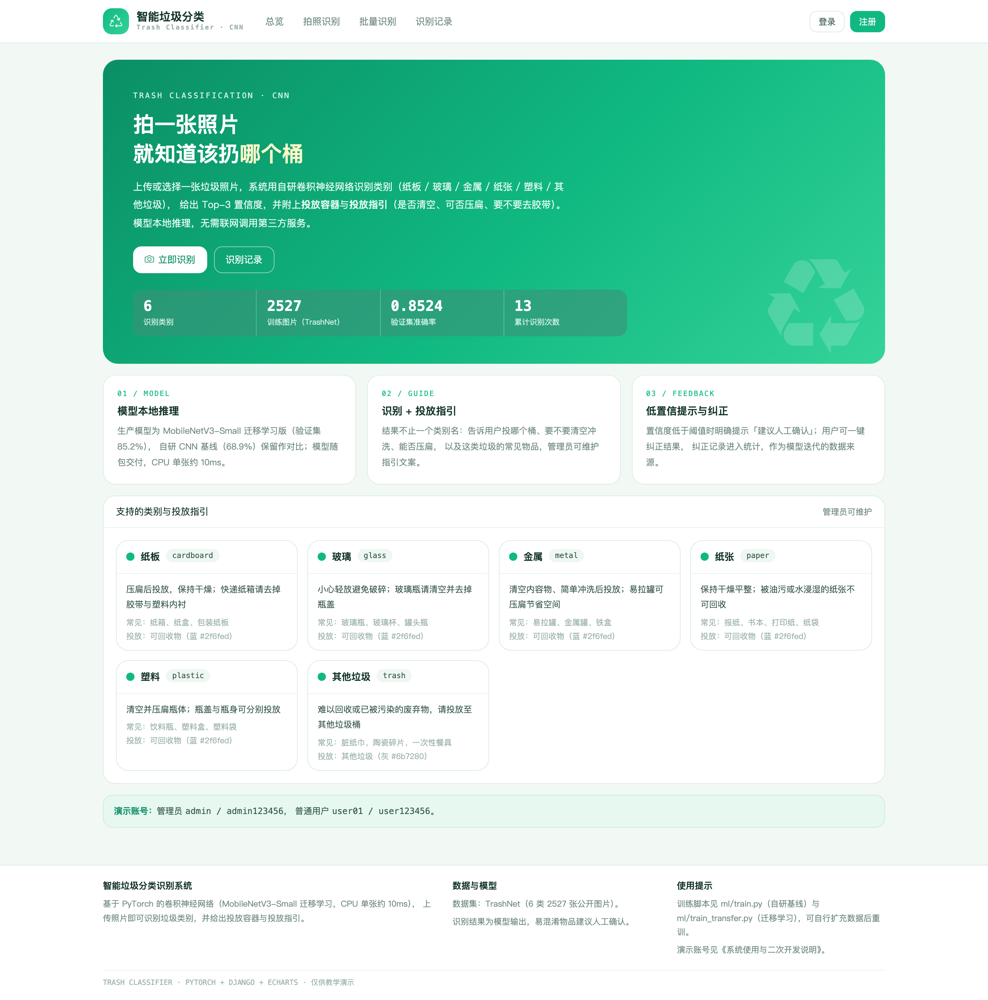
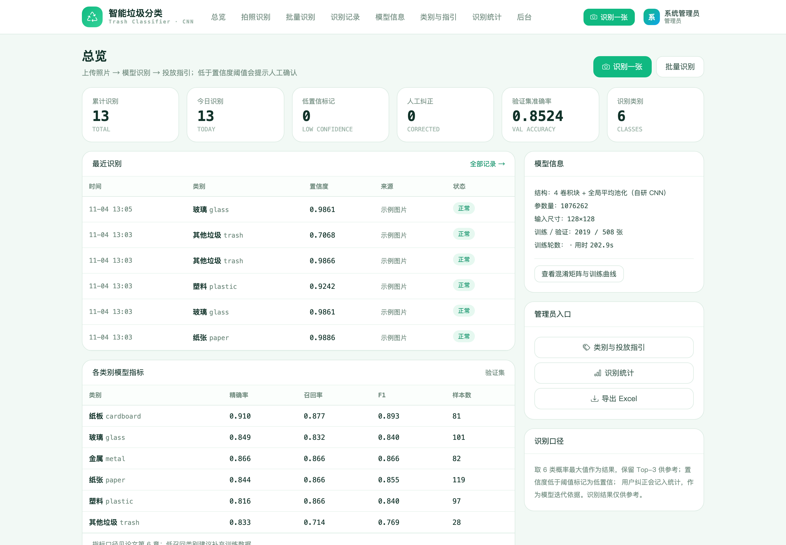
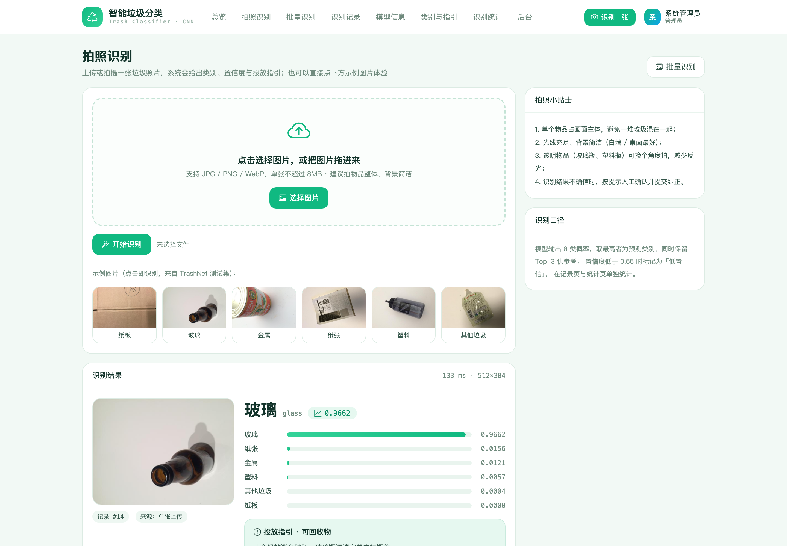
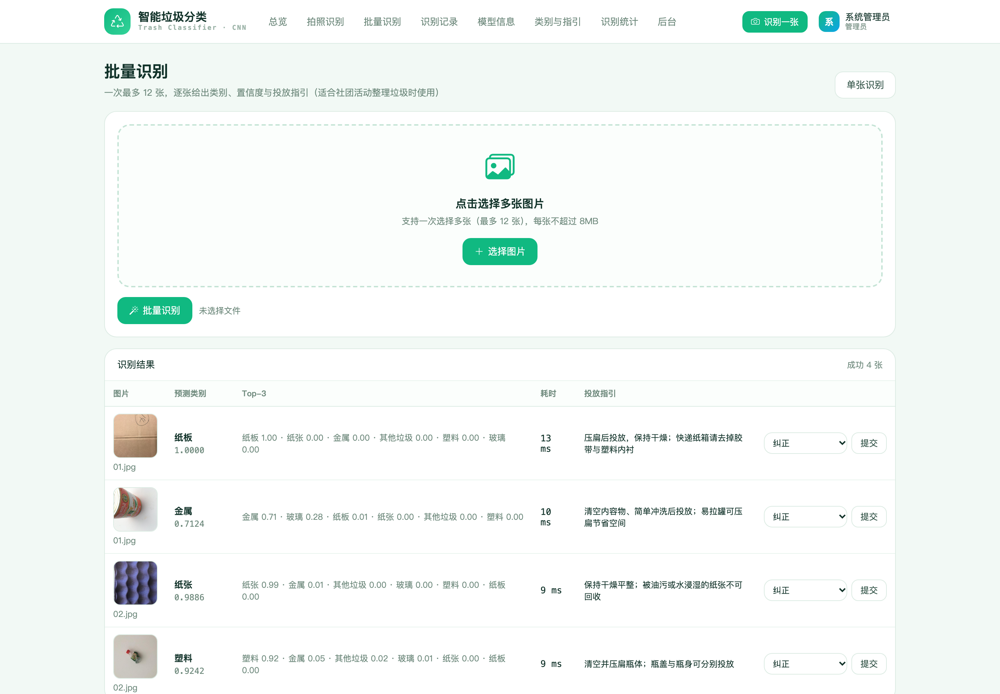
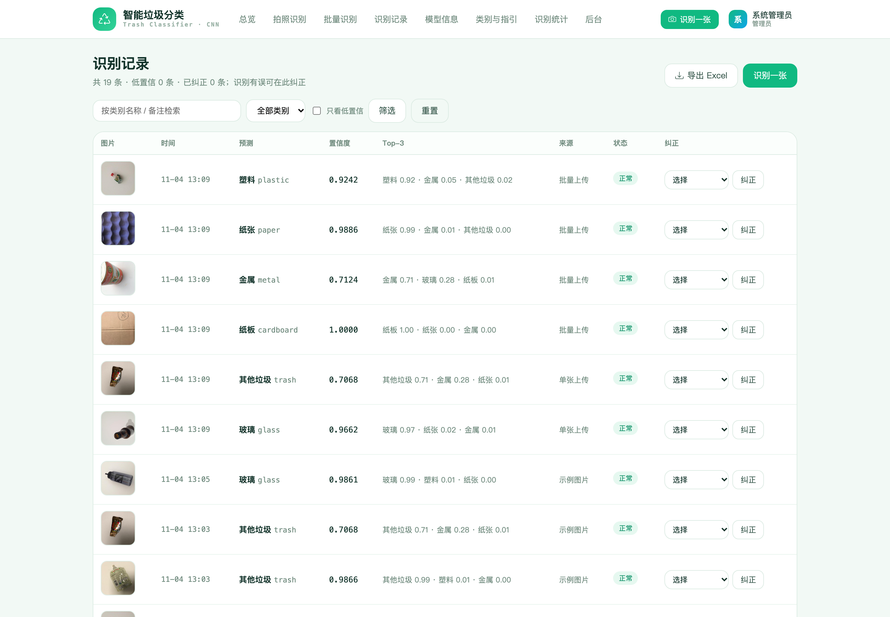
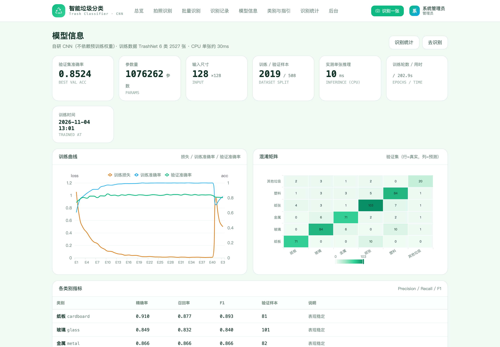
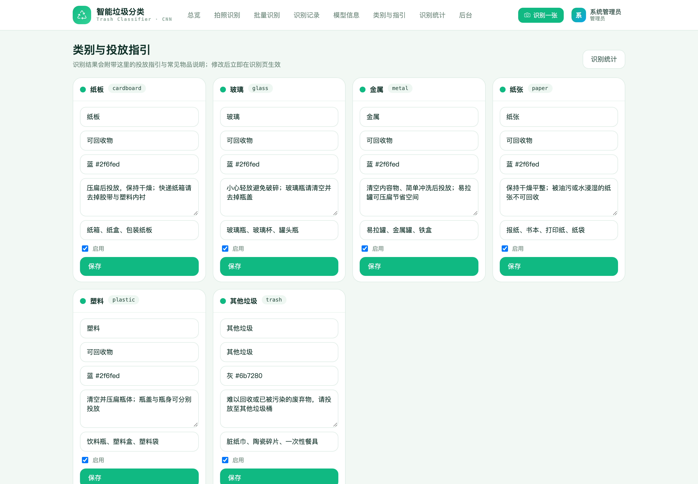
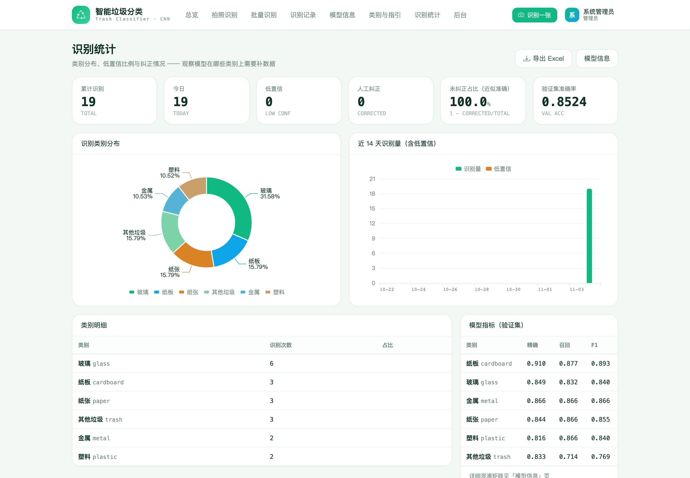
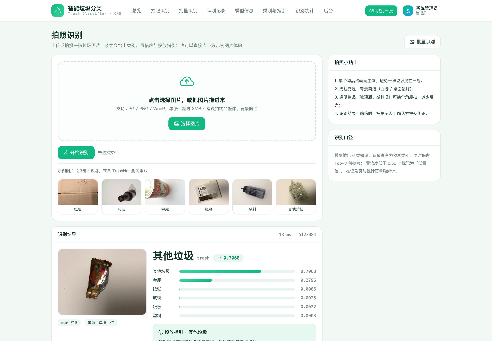

# 012 基于 PyTorch 的垃圾分类识别系统-设计展示

> **代码有偿获取 可接受定制 微信联系方式: csbysj2020 或 ACE2487，备注(BS)**

> **完整源码与全套文档 · 在线自助获取 >>> [https://mbd.pub/o/bread/YZaWlJ5qbA==](https://mbd.pub/o/bread/YZaWlJ5qbA==)**

> **成品页（功能介绍 / 更多选题）>>> [https://bishe.suilang.net/products/pytorch-trash-classifier](https://bishe.suilang.net/products/pytorch-trash-classifier)**

> 

> 

## 视频

> **点击查看 >>> [https://www.bilibili.com/video/BV1bzxQ6ZEwc/](https://www.bilibili.com/video/BV1bzxQ6ZEwc/)**

## 项目简介

面向校园与社区的垃圾分类识别系统：上传或拍摄照片，用卷积神经网络识别类别（纸板 / 玻璃 / 金属 / 纸张 / 塑料 / 其他垃圾），给出 Top-3 置信度与投放容器、投放指引；支持批量识别、低置信提示与人工纠正闭环。论文含「自研 CNN 基线 vs 迁移学习」对比实验与混淆矩阵分析。

垃圾分类是城市治理与校园管理的日常要求，但具体物品的归类判断对多数人并不直观：带油污的餐盒属于其他垃圾、玻璃瓶与透明塑料瓶外观相似、脏纸巾不可回收。

针对这一问题，本项目设计并实现了一套基于 PyTorch 的垃圾分类识别系统。

系统使用公开数据集 TrashNet（6 类 2527 张图片），按类别分层 8:2 划分训练与验证集（固定随机种子保证可复现），并采用随机水平翻转、±12° 旋转与颜色抖动做数据增强。

本仓库为**设计展示**：包含项目说明、技术架构、实验结果与运行截图；完整源码、任务书、开题报告、毕业论文与使用说明可通过上方链接自助获取，成品页可查看更多选题，也可联系微信咨询定制。

## 功能特性

1. 两组对比实验：自研 CNN 基线（64×64，1.18M 参数，验证 68.90%）与 MobileNetV3-Small 迁移学习（验证 85.24%）

2. 可复现训练：TrashNet 分层 8:2 划分（固定种子）、增强口径明确，指标由脚本产出，基线指标一并保留

3. 混淆矩阵分析：定位玻璃↔塑料互相误判与其他垃圾召回偏低（该类样本仅 137 张）并给出改进方向

4. 识别结果卡：类别、置信度、Top-3 概率条，附投放容器与投放指引（清空 / 压扁 / 去胶带）

5. 批量识别：一次最多 12 张，逐张给出类别与指引，适合社团集中整理垃圾

6. 低置信兜底：置信度低于阈值提示人工确认；模型缺失时明确提示而不是返回随机结果

7. 纠正闭环：一键纠正结果，纠正分布进入统计，作为下一轮补数据依据

8. 类别与指引维护 + 识别统计 + 三张工作表 Excel 导出；CPU 单张推理约 10ms

## 技术架构

| 项目 | 说明 |
| --- | --- |
| 编程语言 | Python 3.8 及以上 |
| 深度学习 | PyTorch 2.x + torchvision（MobileNetV3-Small，模型随包交付） |
| Web 框架 | Django 4.2 |
| 推理环境 | CPU 即可（单张约 10ms），GPU 非必需 |
| 数据库 | MySQL 5.7 及以上（交付默认 SQLite，免安装） |
| 可视化 | ECharts 5（已内置本地文件，离线可用） |
| 报表导出 | openpyxl |
| 操作系统 | Windows / macOS / Linux |
| 启动方式 | 双击一键脚本，或 python manage.py runserver |

## 目录结构

以下为完整交付版的结构（本仓库仅作设计展示）：

```
pytorch-trash-classifier/
├── 任务书/
│   └── 毕业设计任务书.docx
├── 开题报告/
│   └── 毕业设计开题报告.docx
├── 最终论文/
│   ├── 图/
│   │   ├── 图3-1_系统用例图.png
│   │   ├── 图4-1_系统架构图.png
│   │   ├── 图4-2_功能模块图.png
│   │   ├── 图4-3_模型训练与评估流程图.png
│   │   └── 图4-4_数据库ER图.png
│   └── 基于PyTorch的垃圾分类识别系统设计.docx
├── 源码/
│   ├── accounts/
│   │   ├── migrations/
│   │   ├── __init__.py
│   │   ├── admin.py
│   │   ├── apps.py
│   │   ├── forms.py
│   │   ├── models.py
│   │   ├── urls.py
│   │   └── views.py
│   ├── data/
│   │   └── demo/
│   ├── greenbin/
│   │   ├── __init__.py
│   │   ├── asgi.py
│   │   ├── settings.py
│   │   ├── urls.py
│   │   └── wsgi.py
│   ├── media/
│   │   └── recog/
│   ├── ml/
│   │   ├── artifacts/
│   │   ├── __init__.py
│   │   ├── apps.py
│   │   ├── service.py
│   │   ├── train.py
│   │   ├── train_transfer.py
│   │   ├── urls.py
│   │   └── views.py
│   ├── recycle/
│   └── …
└── …
```

## 数据与实验结论

- 模型方面完成了两组对比实验：其一是自研小型卷积神经网络（4 个卷积块 + 全局平均池化，约 118 万参数，输入 64×64，不依赖预训练权重），验证集准确率 68.90%，CPU 训练 12 轮约 1237 秒；其二是迁移学习方案（MobileNetV3-Small ImageNet 预训练骨干冻结提取特征 + 分类头训练 + 最后一个卷积块微调），验证集准确率 85.24%，训练仅约 203 秒。
- 论文进一步给出每类 Precision / Recall / F1 与混淆矩阵分析，指出玻璃与透明塑料的互相误判（101 张玻璃中有 10 张被判为塑料）以及「其他垃圾」类因样本仅 137 张而召回偏低，这些结论直接指导了数据扩充方向。
- 工程实现上，系统把模型与元信息随包交付、进程内单例加载、推理预处理与训练严格一致（Resize + CenterCrop + ImageNet 归一化），CPU 单张推理约 10 毫秒；业务侧提供识别结果卡（Top-3 概率与投放容器、投放指引）、批量识别、低置信提示、人工纠正闭环、类别与指引维护、识别统计与 Excel 导出。

## 交付内容

1. 完整源码（已跑通，含训练好的模型与指标文件、演示数据库与示例识别记录）
2. 两个训练脚本：自研 CNN 基线（可复现）与 MobileNetV3-Small 迁移学习（交付模型）
3. 模型产物：model.pt / meta.json（指标与混淆矩阵）/ baseline.json（基线指标）
4. 毕业设计任务书（Word）
5. 开题报告（Word）
6. 毕业论文（Word，七章制，含对比实验与混淆矩阵分析章节）
7. 系统使用与二次开发说明（Word + md）
8. 10 张系统运行截图

## 常见问题

**项目能直接跑起来吗？**

能。交付包里已带训练好的模型与演示数据库，安装依赖（含 PyTorch）后双击一键脚本即可；推理在 CPU 上运行，单张约 10ms。

**识别准确率是多少？**

交付模型（MobileNetV3-Small 迁移学习）验证集准确率 85.24%，验证集 508 张；各类别 F1 在 0.77–0.89 之间，页面「模型信息」可看到混淆矩阵与每类指标。

**为什么还带了一个 68.9% 的模型指标？**

那是自研 CNN 基线（不依赖预训练权重的 4 卷积块网络）。论文把它与迁移学习做对比实验，说明迁移学习在同一切分上把准确率从 68.90% 提升到 85.24%、训练时间缩短约 84%。

**哪些类别容易认错？**

玻璃与透明塑料互相误判（101 张玻璃中 10 张被判塑料），原因是材质外观相近；「其他垃圾」召回偏低，因为公开数据集中该类只有 137 张样本。

**识别不准怎么办？**

页面提供「识别有误？选择正确类别」的纠正入口，纠正记录会进入统计；同时低置信结果会明确提示「建议人工确认」，避免误信。

**模型是怎么训练出来的？**

数据集为 TrashNet（6 类 2527 张公开图片），按类别分层 8:2 划分并固定随机种子，训练脚本随源码提供，指标可完整复现。

## 截图











